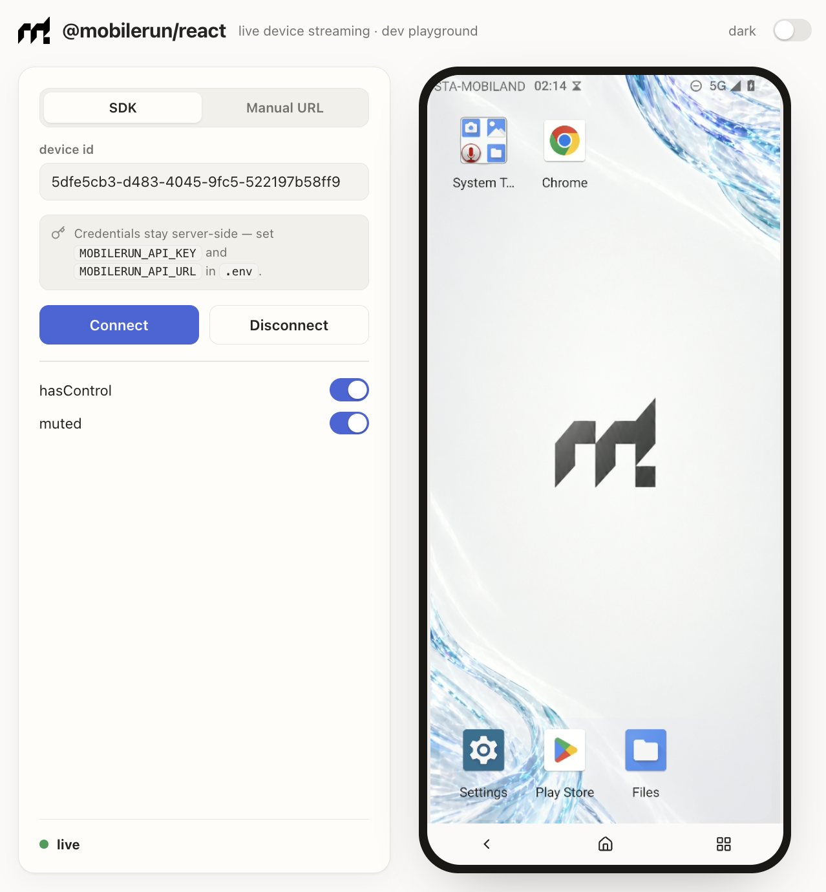

<p align="center">
  <picture>
    <source media="(prefers-color-scheme: dark)" srcset="assets/mobilerun-dark.png" />
    <source media="(prefers-color-scheme: light)" srcset="assets/mobilerun.png" />
    
  </picture>
</p>

<h1 align="center">@mobilerun/react</h1>

<p align="center">
  <strong>React components for embedding Mobilerun's native streaming.</strong><br />
  Live WebRTC video + full scrcpy remote control of a cloud device, in any React app.
</p>

<div align="center">

<a href="https://docs.mobilerun.ai">📕 Documentation</a>
·
<a href="https://cloud.mobilerun.ai">☁️ Mobilerun Cloud</a>

[](https://www.npmjs.com/package/@mobilerun/react)
[](./LICENSE)
[](https://mobilerun.ai)
[](https://react.dev)
[](https://discord.gg/ZZbKEZZkwK)

</div>

<p align="center">
  
</p>

## ✨ What you get

Drop a live, controllable cloud device (iOS/ Android) into any React app:

- 📺 **`<DeviceStream />`** — WebRTC video with touch, swipe and keyboard control, plus automatic reconnects with exponential backoff and a retry UI once attempts are exhausted.
- 🪝 **`useDeviceStream()`** — resolves a device's stream credentials from [`@mobilerun/sdk`](https://www.npmjs.com/package/@mobilerun/sdk), polling while it boots.
- ✅ **`<TaskApproval />`** + **`useTaskApproval()`** — show a task's pending human approval (e.g. "enter payment card X into app Y") with a countdown and Approve/Deny buttons. See [Task approvals](#-task-approvals).
- 🧭 **`<NavigationBar />`**, **`<StreamStatusPill />`**, **`<RemoteControl />`** — the surrounding chrome and a lower-level escape hatch.
- 🎨 **Prebuilt stylesheet** — no Tailwind setup required, themeable via CSS variables.
- 📦 **Typed** — ships its own `.d.ts`; React and the SDK are peer dependencies.

## 📦 Install

```sh
npm install @mobilerun/react @mobilerun/sdk react react-dom
```

`react`, `react-dom` and `@mobilerun/sdk` are peer dependencies.

## 🚀 Quick start

The SDK's `Device` already carries everything the stream needs (`streamUrl` + `streamToken`). `useDeviceStream` fetches them and refreshes them when the stream reconnects:

> ⚠️ **`MOBILERUN_API_KEY` is a secret API key — never ship it to the browser.** It grants full account access, so the snippet below assumes a server-only context (RSC, route handler, SSR). In a client component, resolve `streamUrl` + `streamToken` on your backend instead and pass only those to `<DeviceStream />` — they're short-lived and scoped to a single device. See [Without the hook](#without-the-hook).

```tsx
import Mobilerun from '@mobilerun/sdk';
import { DeviceStream, useDeviceStream } from '@mobilerun/react';
import '@mobilerun/react/styles.css';

const client = new Mobilerun({ apiKey: process.env.MOBILERUN_API_KEY });

export function DevicePanel({ deviceId }: { deviceId: string }) {
  const { streamUrl, streamToken, state, refetch } = useDeviceStream({ client, deviceId });

  return (
    <div style={{ width: 360, height: 780 }}>
      <DeviceStream
        streamUrl={streamUrl}
        streamToken={streamToken}
        hasControl
        placeholderLabel={state}
        onStreamHealed={refetch}
      />
    </div>
  );
}
```

### Without the hook

Already have the device? Feed its fields straight in — no hook required:

```tsx
const device = await client.devices.retrieve(deviceId);

<DeviceStream streamUrl={device.streamUrl} streamToken={device.streamToken} hasControl />;
```

## ✅ Task approvals

A task can pause and wait for a human to approve a step, for example entering a payment card into an app. `useTaskApproval()` loads the pending approval and `<TaskApproval />` renders it with a countdown and Approve/Deny buttons.

**The decision goes through your backend.** The API key that may approve is a secret and must never reach the browser, so the browser only talks to your own routes. The Mobilerun API owns the approval state and decides: the component renders what it is given and forwards the decision, and the countdown is display only. A 404/409 from the decide call (unknown, already resolved or expired) comes back as an error and triggers a refetch.

### 1. Subscribe a webhook

In your Mobilerun webhook settings, point an endpoint at your backend and filter it to the two approval events: `task.run.approval_requested` and `task.run.approval_resolved`. Events only tell the browser to reload; the fetched approval is the source of truth.

Each delivery carries `X-Mobilerun-Timestamp` (Unix ms) and `X-Mobilerun-Signature: sha256=<hex>`, an HMAC-SHA256 of `"{timestamp}.{rawBody}"` with the endpoint secret. Verify it on the raw body before parsing, and reject timestamps more than 5 minutes off. `example/webhook-signature.ts` has a ready-made verifier.

### 2. Backend sketch

```ts
const ID = /^[A-Za-z0-9_-]+$/;

// 1. Webhook: verify the raw bytes, then push a change signal to the user's browser (SSE, ...)
app.post('/webhooks/mobilerun', async (c) => {
  const secret = process.env.MOBILERUN_WEBHOOK_SECRET;
  if (!secret) return c.json({ error: 'missing_webhook_secret' }, 500);
  const bytes = new Uint8Array(await c.req.arrayBuffer());
  const ok = verifyWebhookSignature({
    secret,
    rawBody: bytes,
    timestamp: c.req.header('X-Mobilerun-Timestamp'),
    signature: c.req.header('X-Mobilerun-Signature'),
  });
  if (!ok) return c.body(null, 401);
  const event = JSON.parse(new TextDecoder().decode(bytes));
  if (event.type === 'task.run.approval_requested' || event.type === 'task.run.approval_resolved') {
    push({ taskId: event.data.taskId });
  }
  return c.body(null, 204);
});

// 2. Pending approval: GET /tasks/{id} → task.pendingApproval (null when none)
app.get('/api/tasks/:id', async (c) => {
  const id = c.req.param('id');
  if (!ID.test(id)) return c.json({ error: 'invalid_id' }, 400);
  // Authenticate the caller and check the task belongs to their user/org first.
  const { task } = await mobilerunGet(`/tasks/${encodeURIComponent(id)}`);
  return c.json({ pendingApproval: task?.pendingApproval ?? null });
});

// 3. Decision: POST /tasks/{id}/approvals/{approvalId} { decision: 'approve' | 'deny' }
app.post('/api/tasks/:id/approvals/:approvalId', async (c) => {
  const id = c.req.param('id');
  const approvalId = c.req.param('approvalId');
  if (!ID.test(id) || !ID.test(approvalId)) return c.json({ error: 'invalid_id' }, 400);
  const { decision } = await c.req.json();
  if (decision !== 'approve' && decision !== 'deny') return c.json({ error: 'invalid_decision' }, 422);
  // Authenticate the caller and check the task belongs to their user/org first.
  const url = `/tasks/${encodeURIComponent(id)}/approvals/${encodeURIComponent(approvalId)}`;
  await mobilerunPost(url, { decision });
  return c.body(null, 204);
});
```

Authenticate every route and check that the task belongs to the signed-in user or organization before forwarding. A delivery can be replayed within the 5-minute window; that is harmless here because events only trigger a refetch. Dedupe on the event `id` if your handler does more.

`bun run example` runs a working version of all three plus an SSE endpoint. It is for local use only: it binds to `127.0.0.1` and its task and SSE routes are unauthenticated.

### 3. Client

```tsx
import { TaskApproval, useTaskApproval, type PendingApproval } from '@mobilerun/react';
import '@mobilerun/react/styles.css';

export function Approval({ taskId }: { taskId: string }) {
  const { approval, decide, isDeciding, decision, error } = useTaskApproval({
    taskId,
    fetchApproval: async (id) => {
      const res = await fetch(`/api/tasks/${encodeURIComponent(id)}`);
      if (!res.ok) throw new Error(`HTTP ${res.status}`);
      return ((await res.json()) as { pendingApproval: PendingApproval | null }).pendingApproval;
    },
    decide: async ({ taskId, approvalId, decision }) => {
      const url = `/api/tasks/${encodeURIComponent(taskId)}/approvals/${encodeURIComponent(approvalId)}`;
      const res = await fetch(url, {
        method: 'POST',
        headers: { 'content-type': 'application/json' },
        body: JSON.stringify({ decision }),
      });
      if (!res.ok) throw new Error(`HTTP ${res.status}`);
    },
    // Optional push: reload when your backend signals a change. Without it the hook polls every 3 s.
    subscribe: (taskId, onChange) => {
      const source = new EventSource(`/api/events?taskId=${encodeURIComponent(taskId)}`);
      source.onmessage = onChange;
      return () => source.close();
    },
  });

  return (
    <TaskApproval
      approval={approval}
      onDecide={decide}
      isPending={isDeciding}
      decision={decision}
      error={error}
      // device={<DeviceStream … />}  // optional live device next to the details
    />
  );
}
```

`<TaskApproval />` renders an inline card (wrap it in your own dialog if you want one) and nothing when `approval` is `null`. When you pass `device`, the card shows it next to the details from `md` up; below `md` a Details/Device switch toggles between the two while the device stays mounted, so a live stream never reconnects. The device slot has a fixed height and clips overflow, so the device element should fill it (`height: 100%`). For an unknown `kind` or unexpected `details` it shows a generic "Waiting for approval" body with the same buttons.

### Show it as a bottom sheet

The host owns the sheet or dialog; the library ships only the card. Render `<TaskApproval>` inside your own wrapper while `approval` is non-null. The CSS below turns the wrapper into a sheet below `md` (767px) and leaves it unstyled above:

```tsx
{approval && (
  <div className="sheet-backdrop">
    <div className="sheet" role="dialog" aria-modal="true" aria-label="Task approval">
      <TaskApproval approval={approval} onDecide={decide} isPending={isDeciding} decision={decision} error={error} />
    </div>
  </div>
)}
```

```css
@media (max-width: 767px) {
  .sheet-backdrop { position: fixed; inset: 0; z-index: 50; display: flex; align-items: flex-end; background: rgba(0,0,0,.45); }
  .sheet { width: 100%; max-height: 92vh; overflow-y: auto; border-radius: 24px 24px 0 0; background: var(--background); animation: sheet-up .35s cubic-bezier(.2,.7,.2,1); }
  @keyframes sheet-up { from { transform: translateY(100%); } }
  @media (prefers-reduced-motion: reduce) { .sheet { animation: none; } }
}
```

As a modal, the host moves focus into the sheet and makes the page behind it inert, or uses its own dialog component.

For dark mode put `.dark` on any ancestor, or override the CSS variables (`--background`, `--card`, `--destructive`, …).

### Labels and i18n

Every user-visible string can be replaced through the `labels` prop; see `TaskApprovalLabels` for all keys. `{time}` in `timeLeft` is replaced with the remaining time.

```tsx
<TaskApproval
  approval={approval}
  onDecide={decide}
  labels={{ approve: 'Freigeben', deny: 'Ablehnen', timeLeft: 'Noch {time}' }}
/>
```

## 🧪 Try it locally

The repo ships the playground shown above — paste an API key + device id, or a raw `streamUrl` + `streamToken`, and stream a real device:

```sh
bun install
bun run example     # serves the playground at http://localhost:3000
```

In SDK mode the example server exposes one narrow helper endpoint backed by `@mobilerun/sdk` so the API key can stay server-side while retrieving `streamUrl` and `streamToken`. The stream WebSocket itself is opened directly by the browser against `streamUrl`; the component appends `streamToken` as `?token=`. The same server also demonstrates [task approvals](#-task-approvals) (set `MOBILERUN_WEBHOOK_SECRET` for the webhook route). The server binds to `127.0.0.1` and its task and SSE routes are unauthenticated by design. If you need webhooks delivered to your machine, expose only `/webhooks/mobilerun` (for example through a tunnel that forwards just that path), never the whole server.

## 🎨 Styling & theming

Import the prebuilt stylesheet once, anywhere:

```ts
import '@mobilerun/react/styles.css';
```

It bundles the design tokens, only the Tailwind utilities the components use, the animations, and the structural CSS. It does **not** include Tailwind's preflight/reset, so it won't touch your base styles — and you don't need Tailwind installed.

Retheme by overriding the CSS variables on an ancestor (e.g. `--background`, `--card`, `--muted-foreground`, `--border`, `--primary`), or add a `.dark` ancestor for the bundled dark palette:

```css
:root {
  --primary: oklch(0.55 0.18 268);
  --background: oklch(0.985 0.004 85);
}
```

## 🛠 Building locally

```sh
bun install
bun run build       # tsup (JS + d.ts) + Tailwind (styles.css) → dist/
bun run typecheck
```

## 📄 License

[Apache-2.0](./LICENSE)
