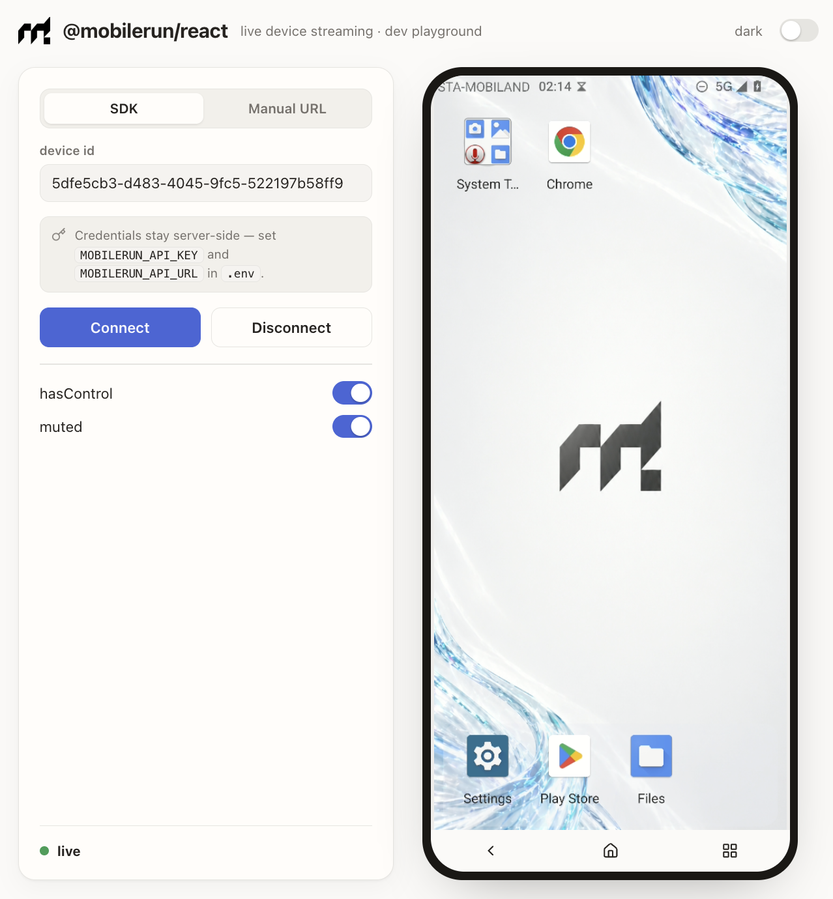

<p align="center">
  <picture>
    <source media="(prefers-color-scheme: dark)" srcset="assets/mobilerun-dark.png" />
    <source media="(prefers-color-scheme: light)" srcset="assets/mobilerun.png" />
    
  </picture>
</p>

<h1 align="center">@mobilerun/react</h1>

<p align="center">
  <strong>React components for embedding Mobilerun's native streaming.</strong><br />
  Live WebRTC video + full scrcpy remote control of a cloud device, in any React app.
</p>

<div align="center">

<a href="https://docs.mobilerun.ai/partners">🤝 Partner guide</a> · <a href="https://docs.mobilerun.ai">📕 Documentation</a> · <a href="https://cloud.mobilerun.ai">☁️ Mobilerun Cloud</a>

[](https://www.npmjs.com/package/@mobilerun/react)
[](https://react.dev)
[](./LICENSE)
[](https://discord.gg/ZZbKEZZkwK)

**React** · [Android](https://github.com/droidrun/mobilerun-android) · [iOS](https://github.com/droidrun/mobilerun-swift) · [Flutter](https://github.com/droidrun/mobilerun-flutter)

</div>

> **Building Mobilerun phones into your platform?** Start with the [Partner guide](https://docs.mobilerun.ai/partners). It walks through the API key, one phone per user, stream keys and live viewing step by step.

<table>
<tr>
<td width="280" valign="top">
  
</td>
<td valign="top">
<strong>In this package</strong>
<ul>
  <li><code>DeviceStream</code> — video, touch, keyboard control and automatic reconnects.</li>
  <li><code>useDeviceStream</code> — stream URL and device state, with boot polling.</li>
  <li><code>TaskApproval</code> / <code>useTaskApproval</code> — approval cards and decisions.</li>
  <li><code>NavigationBar</code> / <code>StreamStatusPill</code> — stream controls and status.</li>
  <li><code>RemoteControl</code> — lower-level stream and input control.</li>
  <li>Prebuilt stylesheet — themeable with CSS variables.</li>
</ul>
<p>Lower-level hooks and scrcpy helpers: see <a href="docs/default-ui.md#lower-level-exports">docs/</a>.</p>
<strong>Requirements</strong>
<ul>
  <li>React and React DOM 18 or 19, in a browser with WebRTC.</li>
  <li><code>@mobilerun/sdk &gt;=2.0.0</code>; object helpers need 6.2+, webhook example 6.2.1+.</li>
  <li>A Mobilerun API key on your server.</li>
</ul>
</td>
</tr>
</table>

## Install

```sh
npm install @mobilerun/react @mobilerun/sdk react react-dom
```

`react`, `react-dom` and `@mobilerun/sdk` are peer dependencies.

## Quick start

1. Your server mints a short-lived stream key for one device with your API key
   (`POST /v1/identity/stream-keys`). Follow the [Partner guide](https://docs.mobilerun.ai/partners).
2. Your app's `tokenProvider` asks your server for a key before each connection.
3. The SDK opens the stream with that key, one key per connection, and reconnects with a fresh one.

Keep `MOBILERUN_API_KEY` on your server. This mint handler excerpt uses the SDK's `/v1` base URL;
see [Stream keys](docs/stream-keys.md) for route setup, metadata fetching and error handling.

```ts
import { MobilerunSDK } from '@mobilerun/sdk';
const sdk = new MobilerunSDK({ logLevel: 'off' }); // server only
export async function mintStreamKey(deviceId: string): Promise<Response> {
  // Authenticate your user and check they own the device before minting.
  const { key, keyId, expiresAt } = await sdk.api.post<{ key: string; keyId: string; expiresAt: string }>(
    '/identity/stream-keys', { body: { deviceId, ttlSeconds: 120 }, maxRetries: 0 },
  );
  return Response.json({ key, keyId, expiresAt }, { status: 201, headers: { 'Cache-Control': 'no-store' } });
}
```

Pass a stream URL fetched through your backend and a callback that calls your mint route:

```tsx
import { DeviceStream } from '@mobilerun/react';
import '@mobilerun/react/styles.css';
export function DevicePanel({ deviceId, streamUrl }: { deviceId: string; streamUrl: string }) {
  const tokenProvider = async () => {
    const res = await fetch(`/api/v1/devices/${encodeURIComponent(deviceId)}/stream-key`, { method: 'POST', cache: 'no-store' });
    if (!res.ok) throw new Error('Stream key request failed');
    return (await res.json()).key;
  };
  return <div style={{ width: 360, height: 780 }}><DeviceStream streamUrl={streamUrl} tokenProvider={tokenProvider} hasControl /></div>;
}
```

Never log or cache stream keys. Your backend must authenticate callers and authorize the device.
The [full example](docs/stream-keys.md) also shows `useDeviceStream` and legacy compatibility.

`tokenProvider` runs before every connection attempt, the first one and each reconnect, and the SDK
never reuses a key it returns. **Use it: stream keys are single-use, so only a provider can reconnect.**

The static `streamToken` prop is **deprecated** and an explicit exception to that rule: it is kept until the
legacy token is removed, and the SDK passes the same value again on every reconnect. A single-use key
given this way is rejected on the second attempt, so the stream ends in the Retry state
(`connection_refused`). The component logs one console warning per mount.

React to failures and white-label the texts:

```tsx
<DeviceStream
  streamUrl={streamUrl}
  tokenProvider={tokenProvider}
  hasControl
  onError={({ reason, attempt, final }) => report(reason, attempt, final)}
  labels={{ connecting: 'Starting…', disconnected: 'Reconnecting', unavailable: 'Phone unavailable', retry: 'Try again' }}
/>
```

`reason` is `credentials_unavailable` (your provider threw or took longer than 10 s),
`connection_refused` (the socket closed before it opened: a used, expired or wrong key, a wrong
device or a refused origin; browsers cannot see the HTTP status), `disconnected` (an open session
dropped, including the 30-minute server cap) or `unknown`. `final: true` means retries stopped and
the Retry button is showing. `labels` replaces every text the component renders.

## Guides

| Guide | Covers |
| --- | --- |
| [Stream keys](docs/stream-keys.md) | Server routes, device metadata, `tokenProvider`, retries and legacy tokens. |
| [Components and styling](docs/default-ui.md) | Components, prebuilt CSS, theme variables and dark mode. |
| [Task approvals](docs/task-approvals.md) | Webhooks, backend decisions, cards, bottom sheets and labels. |

## Contributing

See [CONTRIBUTING.md](CONTRIBUTING.md) for builds, tests, conformance fixtures and the example app.
Report vulnerabilities privately as described in [SECURITY.md](SECURITY.md).

## License

[Apache-2.0](LICENSE)
